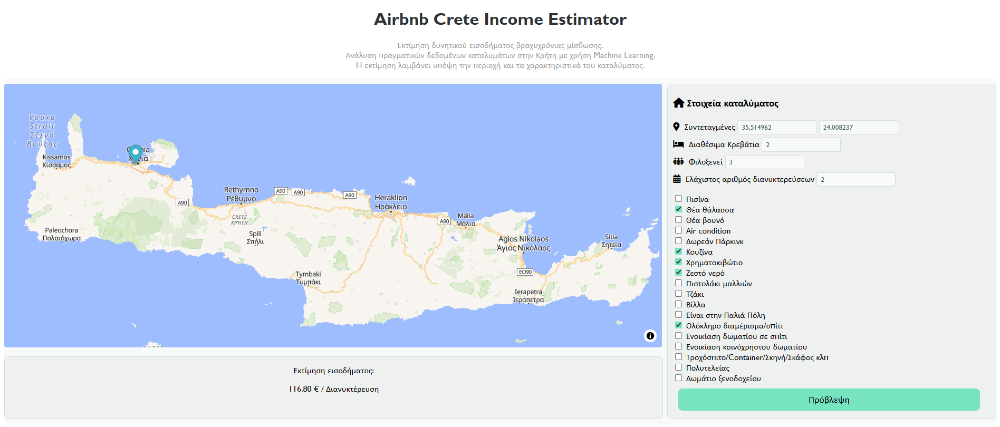

# Airbnb Income Estimator

This project was created to estimate the price / night for an AirBnB listing, based on the location and the house features.

This is the new version of the application, running in Django.
The original backend version and first approach can be found in the [legacy](legacy/) folder.

## About

The admin can upload listing files from [insideairbnb.com/](https://insideairbnb.com) of *any location* to the application, and train the model. Based on these data, it can make price predictions for accommodation.

Map : [OpenFreeMap](https://openfreemap.org/)

Deployed application for Crete : [Live]https://tkoutsogiannakis.site/airbnb-crete-income-estimator

 

**Note:** The application interface is in Greek, designed for Greek-speaking users.

## Features

- Simple web interface
- Machine learning predictions (scikit-learn RandomForestRegressor)
- User authentication (only admin has access to load files and train the model)

## Future Features

- Prediction of estimated occupancy.
- Prediction of estimated annual income.
- Additional languages.
- More efficient way to check when the user is searching outside the covered areas.
- Expansion to more areas.

## Tech Stack

- **Python 3.12.3**
- **Backend:** Django 6.1.1
- **Database:** Sqlite
- **Frontend:** HTML, CSS
- **Machine Learning:** scikit-learn, pandas
- **Server:** Ubuntu, Nginx + Gunicorn
- **Deployment:** Docker Compose, Cloudflare Tunnel

## Local Development Setup

- Clone repository
- python -m venv venv
- Activate virtual enviroment: source venv/bin/activate (Linux) / venv\Scripts\activate (Windows)
- pip install -r requirements.txt
- cp .env.example .env
- python -c "from django.core.management.utils import get_random_secret_key; print(get_random_secret_key())"
- Paste the SECRET_KEY in the .env file.

- **Uncomment the local section on .env file. Comment the local docker and public docker.**

- python manage.py migrate 
- python manage.py createsuperuser
- python manage.py runserver
- Access here: http://localhost:8000/

### Docker Local Setup

- Clone repository
- cp .env.example .env
- python -c "from django.core.management.utils import get_random_secret_key; print(get_random_secret_key())"
- Paste the SECRET_KEY in the .env file.

- **Uncomment the local docker section on .env file. Comment the local and public docker.**

- docker compose -f docker-compose.local.yml up -d --build
- docker compose -f docker-compose.local.yml exec web python manage.py createsuperuser
- Access here: http://localhost:8000/

## Live

**Disclaimer:** Predictions are estimates based on publicly available listing data from [Inside Airbnb](https://insideairbnb.com) and may not match actual prices. The data is subject to Inside Airbnb's own terms of use.

## Author

Tilemachos Koutsogiannakis  
GitHub: [@TelisK](https://github.com/TelisK)

## License

This project is licensed under the MIT License.